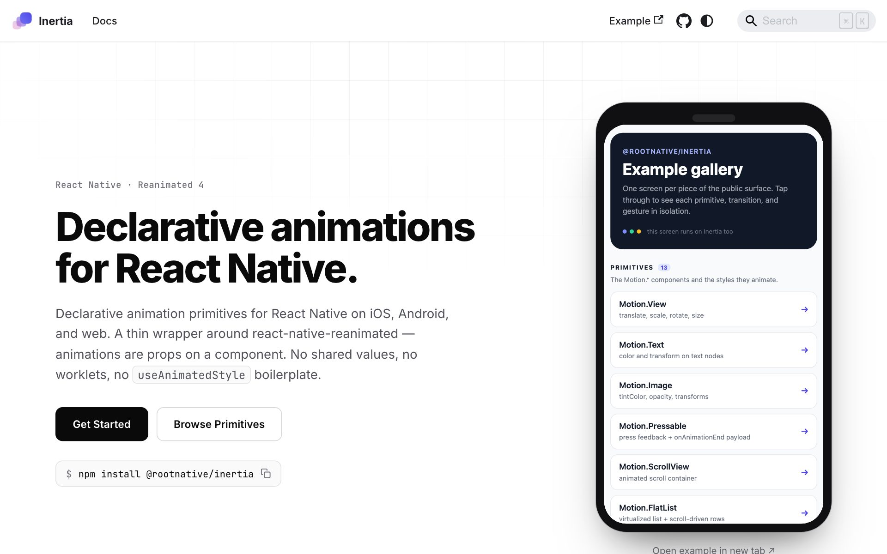
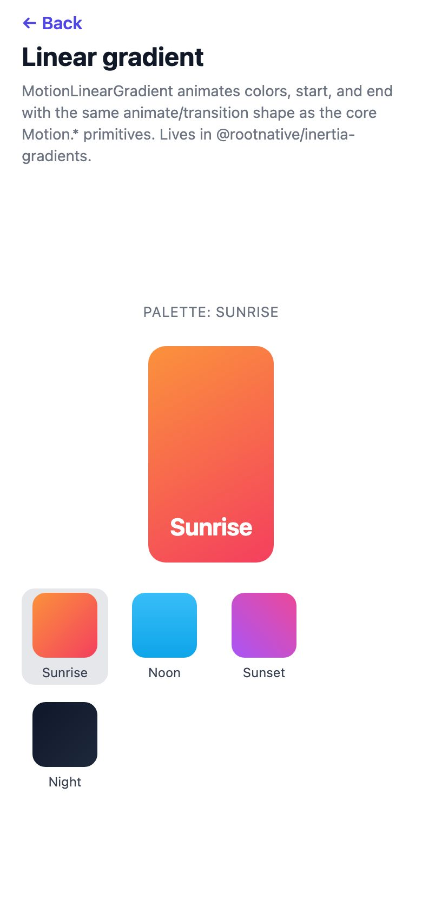
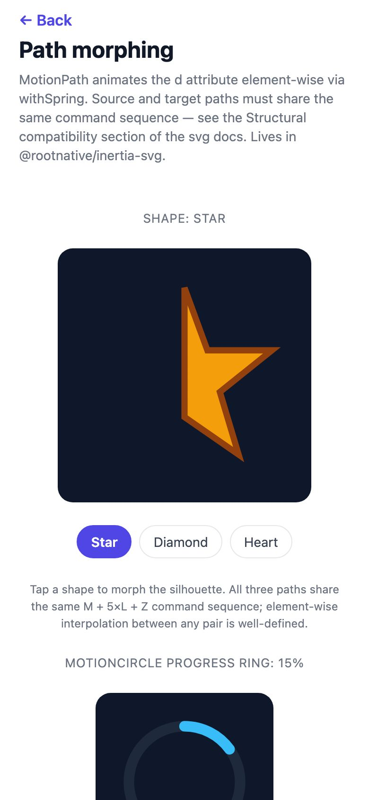
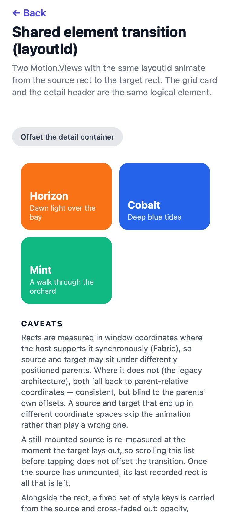
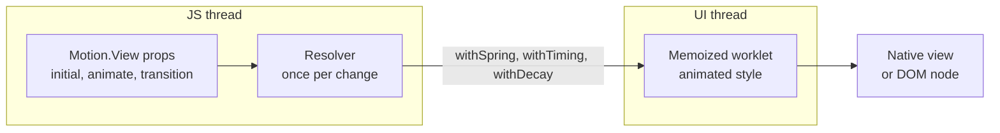

<p align="center">
  <a href="https://rootnative.github.io/inertia/">
    <picture>
      <source media="(prefers-color-scheme: dark)" srcset="assets/brand/inertia-mark-dark.svg" />
      
    </picture>
  </a>
</p>

<h1 align="center">Inertia</h1>

<p align="center">
  Declarative animations for React Native, on iOS, Android, and the web.<br />
  An animation is a prop on a component: no worklets, no shared values, no <code>useAnimatedStyle</code>.
</p>

<p align="center">
  <a href="https://github.com/rootnative/inertia/actions/workflows/ci-build.yml"></a>
  <a href="https://github.com/rootnative/inertia/actions/workflows/compat.yml"></a>
  <a href="https://github.com/rootnative/inertia/actions/workflows/deploy-web.yml"></a>
  <a href="https://www.npmjs.com/package/@rootnative/inertia"></a>
  
  
  
  <a href="LICENSE"></a>
</p>

<p align="center">
  <a href="https://rootnative.github.io/inertia/example/"><b>Open the live demo</b></a>
  ·
  <a href="#-try-it">Try it</a>
  ·
  <a href="#-quick-start">Quick start</a>
  ·
  <a href="https://rootnative.github.io/inertia/introduction/">Documentation</a>
  ·
  <a href="https://rootnative.github.io/inertia/llms-full.txt">LLM docs</a>
</p>

<p align="center">
  <picture>
    <source media="(prefers-color-scheme: dark)" srcset="assets/docs/screenshots/docs-home-dark.jpg" />
    
  </picture>
</p>

> **Status:** `0.0.24`. The declarative core, layout, and shared elements are complete and tested. Before `1.0.0`, a minor release can still change the API. The [changelog](packages/core/CHANGELOG.md) names each breaking change.

## ✨ Features

| Feature                         | What it does                                                                                                                                  |
| ------------------------------- | --------------------------------------------------------------------------------------------------------------------------------------------- |
| **Animations as props**         | Set `initial`, `animate`, `exit`, and `transition` on a `Motion.*` component. You write no worklet and no shared value.                       |
| **Types for each primitive**    | `Motion.View` takes `ViewStyle` keys, `Motion.Text` takes `TextStyle` keys, and `Motion.Image` takes `ImageStyle` keys.                       |
| **Springs with designer names** | A spring takes `tension`, `friction`, and `mass`. Timing, decay, and no-animation transitions are also available.                             |
| **Sequences and keyframes**     | An array in `animate` runs one step after the other. Each step can have its own transition.                                                   |
| **Variants**                    | Name the states once, then write `animate="open"`. The common case needs no hook.                                                             |
| **One `gesture` prop**          | Each primitive animates its `pressed`, `focused`, `focusVisible`, and `hovered` states. A primitive with no `gesture` prop has no extra cost. |
| **Presence**                    | `<Presence>` plays the `exit` animation before a child unmounts. An exiting child does not take taps.                                         |
| **Layout and shared elements**  | `layout` animates a change of size or position. `layoutId` moves one element between two places in the tree.                                  |
| **Stagger**                     | `<Stagger>` delays each child by its position in the list.                                                                                    |
| **Reduced motion**              | `<MotionConfig>` follows the reduce-motion setting of the OS from end to end. It also holds your named transitions.                           |
| **Hooks when you need them**    | `useMotionValue`, `useSpring`, `useTransform`, `useScroll`, `useInView`, `useHideOnScroll`, and more.                                         |
| **Adapters**                    | Drag, swipe, and pan with Gesture Handler, animated linear gradients, and SVG path morphing. Each adapter is a separate package.              |
| **Fast re-renders**             | The JS thread resolves a transition once per change. A render with the same `animate` makes no new UI-thread closure.                         |

## 📱 Try it

<p align="center">
  
  &nbsp;
  
  &nbsp;
  
</p>

<table>
  <tr>
    <th width="50%">In a browser</th>
    <th width="50%">On a phone</th>
  </tr>
  <tr>
    <td align="center">
      <a href="https://rootnative.github.io/inertia/example/"><b>rootnative.github.io/inertia/example</b></a>
      <br /><br />
      One screen for each primitive, transition, and hook.<br />
      You do not need an install or an account.
    </td>
    <td align="center">
      Clone this repository, then run<br />
      <code>pnpm install</code> and <code>pnpm run example</code>.
      <br /><br />
      Scan the QR code in the terminal with <b>Expo Go</b>.
    </td>
  </tr>
</table>

## 🚀 Quick start

```bash
npx expo install @rootnative/inertia react-native-reanimated react-native-worklets
```

`npx expo install` picks the Reanimated and Worklets versions that match your
Expo SDK. Expo adds the worklets Babel plugin for you. A bare React Native app
adds `react-native-worklets/plugin` as the last Babel plugin.

```tsx
import { Motion } from '@rootnative/inertia'

export function FadeIn() {
  return (
    <Motion.View
      initial={{ opacity: 0, translateY: 20 }}
      animate={{ opacity: 1, translateY: 0 }}
      transition={{
        opacity: { type: 'timing', duration: 200 },
        translateY: { type: 'spring', tension: 180, friction: 12 },
      }}
    />
  )
}
```

To ship only one primitive, import it from its subpath:
`import { MotionView } from '@rootnative/inertia/view'`.

Install an adapter only when you need it:

```bash
npx expo install @rootnative/inertia-gestures react-native-gesture-handler  # useDrag, useSwipe, usePan
npx expo install @rootnative/inertia-gradients expo-linear-gradient         # MotionLinearGradient
npx expo install @rootnative/inertia-svg react-native-svg                   # MotionPath and SVG shapes
```

> [!IMPORTANT]
> Each release line supports one Expo SDK band. An app on SDK 57 needs
> `0.0.19`. See [Expo SDK compatibility](#-expo-sdk-compatibility).

> [!TIP]
> For the web, run `npx expo install react-dom react-native-web`. A bundler
> without Metro (Vite, webpack, Electron) must run the worklets plugin on
> `node_modules` too. The
> [installation guide](https://rootnative.github.io/inertia/installation/)
> shows the config.

### Transition shapes

| `type`               | Public config keys                        | Maps to                                      |
| -------------------- | ----------------------------------------- | -------------------------------------------- |
| `'spring'` (default) | `tension`, `friction`, `mass`, `velocity` | `withSpring` (converted from spring physics) |
| `'timing'`           | `duration`, `easing`, `delay`             | `withTiming`                                 |
| `'decay'`            | `velocity`, `deceleration`, `clamp`       | `withDecay`                                  |
| `'no-animation'`     | —                                         | direct assignment, no interpolation          |

Each transition also takes `delay` and `repeat` (a count, `'infinite'`, or
`{ count, alternate }`). A map for each property can also hold config keys.
Those keys are the default for each key that the map does not name:
`{ type: 'spring', tension: 120, opacity: { type: 'timing' } }` springs each
key except `opacity`.

The animatable properties are opacity, transforms, size, border radius,
shadows, and colours. The full list is in
[Transitions](https://rootnative.github.io/inertia/transitions/).

## 🧭 How it works



- **The JS thread resolves the config.** Inertia turns `animate` and
  `transition` into Reanimated animations once per change. The worklet only
  runs them. It does not read the config on each frame.
- **The worklets are memoized.** A render with the same `animate` makes no new
  UI-thread closure. A regression test pins this.
- **Reanimated stays hidden.** The public types use react-spring names. A
  component that needs its own animated style imports the render-layer
  primitives from `@rootnative/inertia/reanimated`, so Inertia stays its only
  animation import.

### When not to use Inertia

Inertia is a declarative layer. Some patterns work better one layer down:

- **UI that follows a finger frame by frame** (sliders, swipe to dismiss,
  pinch to zoom). Use [`@rootnative/inertia-gestures`](packages/gestures), or
  `react-native-gesture-handler` with raw Reanimated.
- **Data visualisation that changes on each frame.** Keep the SVG attribute
  interpolation in raw Reanimated, or use
  [`@rootnative/inertia-svg`](packages/svg) to morph paths that have the same
  structure.
- **Custom physics.** Use the hooks layer: `useMotionValue`, `useSpring`, and
  `useTransform`.

The hooks layer has the same shape as Reanimated, so the change of layer is
small. Read the
[migration guide](https://rootnative.github.io/inertia/migrations/from-reanimated/).

## 📦 Packages

| Package                                               | Install size                                                                     | What it holds                                                                                                                       |
| ----------------------------------------------------- | -------------------------------------------------------------------------------- | ----------------------------------------------------------------------------------------------------------------------------------- |
| [`@rootnative/inertia`](packages/core)                |            | The `Motion.*` primitives, the transitions, `<Presence>`, `<MotionConfig>`, `<Stagger>`, layout and shared elements, and the hooks. |
| [`@rootnative/inertia-gestures`](packages/gestures)   |   | `useDrag`, `useSwipe`, and `usePan` on `react-native-gesture-handler`. Optional.                                                    |
| [`@rootnative/inertia-gradients`](packages/gradients) |  | `MotionLinearGradient` on `expo-linear-gradient`, with animatable `colors`, `start`, `end`, and `locations`. Optional.              |
| [`@rootnative/inertia-svg`](packages/svg)             |        | `MotionPath` and SVG shapes on `react-native-svg`, with animatable `d` (path morphing), `fill`, and `stroke`. Optional.             |

The four packages ship in lockstep, with the same version number. Install the
same version of each `@rootnative/inertia*` package that you use.

## 📅 Expo SDK compatibility

Each release line supports one Expo SDK band. Install the line that matches the
SDK of the app.

| Expo SDK | `@rootnative/inertia` and the adapters                          |
| -------- | --------------------------------------------------------------- |
| 58       | `0.0.20` and later                                              |
| 57       | `0.0.11` to `0.0.19` (`npm install @rootnative/inertia@0.0.19`) |
| 54       | `0.0.10` and earlier, with a lockfile that already resolved     |

## 🤖 Docs for AI agents

Each published package ships an [llms.txt](https://llmstxt.org/) file with the
exact API of its version, for example
`node_modules/@rootnative/inertia/llms.txt`. The docs site serves
[llms.txt](https://rootnative.github.io/inertia/llms.txt), an overview, and
[llms-full.txt](https://rootnative.github.io/inertia/llms-full.txt), the full
API reference. The [AI agents guide](https://rootnative.github.io/inertia/ai/)
has a `CLAUDE.md` snippet to copy.

## 📚 Documentation

| Page                                                                                              | Read it to                                                                     |
| ------------------------------------------------------------------------------------------------- | ------------------------------------------------------------------------------ |
| [Introduction](https://rootnative.github.io/inertia/introduction/)                                | Get an overview of the library and make a first animation                      |
| [Installation](https://rootnative.github.io/inertia/installation/)                                | Install the peers, set up the Babel plugin, and learn the platform differences |
| [Primitives](https://rootnative.github.io/inertia/primitives/)                                    | Learn each `Motion.*` component and the styles that it animates                |
| [Transitions](https://rootnative.github.io/inertia/transitions/)                                  | Choose a spring, a timing, or a decay, and see each animatable property        |
| [Variants](https://rootnative.github.io/inertia/variants/)                                        | Name the states of a component and move between them                           |
| [Sequences and repeat](https://rootnative.github.io/inertia/sequences/)                           | Run steps one after the other, and repeat an animation                         |
| [Presence](https://rootnative.github.io/inertia/presence/)                                        | Animate a child out before it unmounts                                         |
| [Stagger](https://rootnative.github.io/inertia/stagger/)                                          | Delay each child by its position                                               |
| [Layout](https://rootnative.github.io/inertia/layout/)                                            | Animate a change of layout, and move a shared element                          |
| [Gestures](https://rootnative.github.io/inertia/gestures/)                                        | Animate the pressed, focused, and hovered states                               |
| [Gestures adapter](https://rootnative.github.io/inertia/gestures-adapter/)                        | Drag, swipe, and pan with Gesture Handler                                      |
| [Gradients](https://rootnative.github.io/inertia/gradients/)                                      | Animate a linear gradient                                                      |
| [SVG](https://rootnative.github.io/inertia/svg/)                                                  | Morph an SVG path, and animate its fill and stroke                             |
| [MotionConfig](https://rootnative.github.io/inertia/motion-config/)                               | Follow the reduce-motion setting, and name your transitions                    |
| [Static export & SSR](https://rootnative.github.io/inertia/static-export/)                        | Keep a pre-rendered page visible when the bundle does not run                  |
| [Testing](https://rootnative.github.io/inertia/testing/)                                          | Test animations in Jest with the preset                                        |
| [Hooks](https://rootnative.github.io/inertia/api/hooks/)                                          | Use the value layer: `useMotionValue`, `useSpring`, `useTransform`, and more   |
| [Migrating from raw Reanimated](https://rootnative.github.io/inertia/migrations/from-reanimated/) | Move Reanimated code to Inertia                                                |

## 🧰 Tech stack

| Layer           | Technology                                                               |
| --------------- | ------------------------------------------------------------------------ |
| Runtime         | React 19.3, React Native 0.88, Expo SDK 58                               |
| Animation       | `react-native-reanimated` 4.7 and `react-native-worklets` 0.13, as peers |
| Language        | TypeScript 5, strict mode                                                |
| Build           | tsup for the packages, Turborepo for the tasks                           |
| Package manager | pnpm 10, with the workspace protocol                                     |
| Tests           | Jest 29 and `@testing-library/react-native`                              |
| Docs            | Docusaurus 3                                                             |
| Delivery        | GitHub Actions, GitHub Pages, and npm with trusted publishing            |

## 🔧 Development

You need Node.js 24 (the version in `.nvmrc`) and pnpm 10.

```bash
git clone https://github.com/rootnative/inertia.git
cd inertia
pnpm install
```

| Command                   | What it does                                                    |
| ------------------------- | --------------------------------------------------------------- |
| `pnpm run build`          | Builds each package with Turborepo                              |
| `pnpm run dev`            | Builds each package in watch mode                               |
| `pnpm run typecheck`      | Runs `tsc --noEmit` in each package                             |
| `pnpm run test`           | Runs Jest in each package                                       |
| `pnpm run lint`           | Runs ESLint                                                     |
| `pnpm run format`         | Formats the repository with Prettier                            |
| `pnpm run example`        | Starts the Expo dev server of the example app                   |
| `pnpm run docs:dev`       | Starts the docs site                                            |
| `pnpm run build:llms`     | Writes the `llms.txt` and `llms-full.txt` files again           |
| `pnpm run check:versions` | Checks that each version reference agrees with the core package |
| `pnpm run clean`          | Removes the build output and `node_modules`                     |

To start the example app on one platform, run `pnpm run example:ios` or
`pnpm run example:android`. Each primitive, sequence, variant, gesture state,
presence transition, and hook has its own screen in
[example/screens/](example/screens/).

### Testing

```tsx
import { renderWithMotion } from '@rootnative/inertia/testing'

const { getByTestId } = renderWithMotion(
  <Motion.View
    testID="card"
    initial={{ opacity: 0 }}
    animate={{ opacity: 1 }}
  />,
)
expect(getByTestId('card').props.style).toMatchObject({ opacity: 1 })
```

The tests of each package are in its `src/__tests__/` folder. The Reanimated
mock ends each animation at once, so a test asserts the **final** state, not a
frame between. The example app is where each frame is checked. Read
[Testing](https://rootnative.github.io/inertia/testing/) for the full contract.

<details>
<summary>Repository layout</summary>

```text
.
├── docs/                  # Docusaurus documentation site, with the live demo
├── example/               # Expo app, one screen for each primitive and hook
├── packages/
│   ├── core/              # @rootnative/inertia: primitives, transitions, hooks, Presence, MotionConfig, layout
│   ├── gestures/          # @rootnative/inertia-gestures: useDrag, useSwipe, usePan
│   ├── gradients/         # @rootnative/inertia-gradients: MotionLinearGradient
│   └── svg/               # @rootnative/inertia-svg: MotionPath and SVG shapes
├── scripts/               # Generators (llms.txt, brand) and the version check
├── turbo.json
└── pnpm-workspace.yaml
```

</details>

## 🤝 Contributing

The code has no semicolons, single quotes, and trailing commas. ESLint uses a
flat config. Do not put a style object inline in JSX: move it to a `const`, a
`useMemo`, or `StyleSheet.create`. TypeScript is strict everywhere.

Three rules stop silent defects in code that runs on the UI thread:

1. Make each callback that runs on the UI thread a worklet.
2. Do not use JS-thread state inside a worklet. Go through a shared value or a
   `runOnJS` boundary.
3. Keep `useAnimatedStyle` deterministic. Read shared values in it, and do not
   change them.

After you edit a file, run Prettier on that file only
(`npx prettier --write path/to/file.ts`).

## 🙏 Credits

- [Reanimated](https://docs.swmansion.com/react-native-reanimated/) by Software
  Mansion runs every animation.
- The API takes ideas from [Framer Motion](https://motion.dev/) and
  [react-spring](https://www.react-spring.dev/).

## 📄 License

[MIT](LICENSE) © 2026 Root Native
