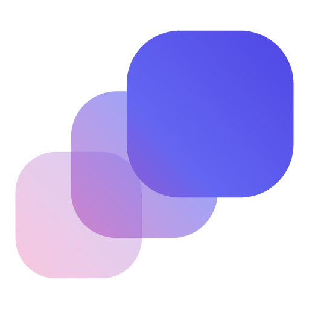

<!--
  Absolute URL, not a relative path: this README is the npm package page, and
  npm does not resolve repository-relative image paths.
-->


# @rootnative/inertia

[](https://www.npmjs.com/package/@rootnative/inertia)
[](https://docs.swmansion.com/react-native-reanimated/)
[](./LICENSE)

Declarative animation primitives for React Native, built as a thin wrapper around [`react-native-reanimated`](https://docs.swmansion.com/react-native-reanimated/). The API takes ideas from Framer Motion (web) and react-spring (cross-platform).

> **Status:** `0.0.28`, stable. Before `1.0.0`, a minor release can still change the API. The [CHANGELOG](https://github.com/rootnative/inertia/blob/main/packages/core/CHANGELOG.md) names each breaking change.

## Install

```sh
pnpm add @rootnative/inertia react-native-reanimated
```

Then enable the [Reanimated Babel plugin](https://docs.swmansion.com/react-native-reanimated/docs/fundamentals/installation).

**Peer dependencies:** `react >=19.3.0`, `react-native >=0.88.0 <0.89.0`, `react-native-reanimated >=4.7.0 <4.8.0`, `react-native-worklets >=0.13.0 <0.14.0`.

Each release line supports one Expo SDK band. Install the line that matches the SDK of the app.

| Expo SDK | `@rootnative/inertia` and the adapters                          |
| -------- | --------------------------------------------------------------- |
| 58       | `0.0.20` and later                                              |
| 57       | `0.0.11` to `0.0.19` (`npm install @rootnative/inertia@0.0.19`) |
| 54       | `0.0.10` and earlier, with a lockfile that already resolved     |

## Quick start

```tsx
import { Motion, Presence } from '@rootnative/inertia'

export function FadeIn() {
  return (
    <Motion.View
      initial={{ opacity: 0, translateY: 20 }}
      animate={{ opacity: 1, translateY: 0 }}
      transition={{
        opacity: { type: 'timing', duration: 200 },
        translateY: { type: 'spring', tension: 180, friction: 12 },
      }}
    />
  )
}
```

## What ships

- **Primitives:** `Motion.View`, `Motion.Text`, `Motion.Image`, `Motion.Pressable`, `Motion.ScrollView`. Each primitive infers its own style type. There is no shared `ViewStyle & TextStyle & ImageStyle` fallback.
- **Sequences and keyframes:** `animate={{ x: [0, 100, 0] }}` with a transition per step, and one `repeat` shape: `number | 'infinite' | { count, alternate }`.
- **Variants:** `variants={{ open, closed }}` with `animate="open"`. For programmatic control, use `useVariants` with `controller={...}`.
- **Gestures:** one `gesture` prop on every primitive: `gesture={{ pressed, focused, focusVisible, hovered }}`. The sub-states layer in priority order (`hovered → focused → focusVisible → pressed`). Each layer fades in and out on its own progress, so an MD3 release while hovered crossfades correctly. Set a transition per layer with `transition.<stateName>`. On web, `focusVisible` follows the `:focus-visible` of the browser, so a click on a button doesn't flash a ring. On native, it tracks `focused`. The prop has zero overhead when you omit it.
- **`<Presence>`:** mount and unmount transitions. An exiting child gets `pointerEvents: 'none'`.
- **`<MotionConfig reducedMotion>`:** follows the reduce-motion setting of the OS from end to end (`'user' | 'never' | 'always'`).
- **`layout` prop:** layout transitions on every primitive. It bridges the `LinearTransition` of Reanimated with the same react-spring vocabulary (`tension`, `friction`, `mass`). It accepts `boolean | TransitionConfig`.
- **Value-layer hooks:** `useMotionValue`, `useSpring`, `useAnimation`, `useTransform`, `useScroll`, `useVariants`, `useGesture`. They are the escape hatch for an animation that the props can't express: a sibling overlay that a parent gesture drives, an indeterminate loop on a standalone shared value, a gesture-smoothed input.
- **Subpath imports per primitive:** `@rootnative/inertia/view`, `/text`, `/image`, `/pressable`, `/scroll-view`.
- **JS-thread resolver, memoized worklets:** the JS thread compiles the `animate` and `transition` objects into baked `withSpring`, `withTiming`, and `withDecay` calls. The worklet body never iterates `Object.keys(...)` at frame time.

## Subpath imports

```ts
import { MotionView } from '@rootnative/inertia/view'
import { MotionText } from '@rootnative/inertia/text'
import { MotionImage } from '@rootnative/inertia/image'
import { MotionPressable } from '@rootnative/inertia/pressable'
import { MotionScrollView } from '@rootnative/inertia/scroll-view'
```

Or use the root entry. The primitives are the same, and a named import tree-shakes, because the package is `sideEffects: false`:

```ts
import { MotionView } from '@rootnative/inertia'
```

The full namespace (`import { Motion } from '@rootnative/inertia'`, then `Motion.View`) can't tree-shake. Access to one property of a literal object keeps the whole object in the bundle. Use a named import when bundle size is important.

## Transitions

| `type`               | Public config keys                        | Maps to                             |
| -------------------- | ----------------------------------------- | ----------------------------------- |
| `'spring'` (default) | `tension`, `friction`, `mass`, `velocity` | `withSpring`                        |
| `'timing'`           | `duration`, `easing`, `delay`             | `withTiming`                        |
| `'decay'`            | `velocity`, `deceleration`, `clamp`       | `withDecay`                         |
| `'no-animation'`     | —                                         | direct assignment, no interpolation |

Every transition also takes `delay` and `repeat`. A per-property map can also carry config keys, which are the default for every key that the map doesn't name: `{ type: 'spring', tension: 120, opacity: { type: 'timing' } }` springs every key except `opacity`. A spring config uses the **react-spring vocabulary** (`tension`, `friction`). The raw `stiffness` and `damping` of Reanimated are never on the public surface.

## Caveats

- **`Motion.Pressable` doesn't support the function form of `style`.** The `Pressable` of React Native accepts `style={({ pressed }) => ...}` and runs it on each state change. Inertia uses the `createAnimatedComponent` wrapper of Reanimated, which drops that form with no error and no warning. Drive the press, focus, and hover styles through `gesture` instead, or compute a conditional style once in render. See [primitives/pressable](https://rootnative.github.io/inertia/docs/primitives/pressable#style-must-be-a-value-not-a-function).
- **Inertia reads `initial` once, on mount.** A change of `initial` after the first render does nothing. Change the component `key`, remount through `<Presence>`, or drive the value through a controller. Pass `initial={false}` to skip the mount animation.
- **Reanimated 4.5.0 to 4.5.2 could show a view at its `initial` value after its animation ends.** The SDK 58 band starts at Reanimated 4.7, which has the fix ([software-mansion/react-native-reanimated#9987](https://github.com/software-mansion/react-native-reanimated/pull/9987)). On SDK 57 with `0.0.19`, install Reanimated 4.5.3 or later in a development build or a store build. Expo Go 57 runs 4.5.1 and keeps the defect. See [installation](https://rootnative.github.io/inertia/installation#prerequisites).

## Animatable properties

Numeric: `opacity`, `translateX`, `translateY`, `scale`, `scaleX`, `scaleY`, `rotate`, `rotateX`, `rotateY`, `width`, `height`, `borderRadius`, `shadowOpacity`, `shadowRadius`, `elevation`. Color: `backgroundColor`, `borderColor`, `color`, `shadowColor`, `tintColor` (Image only; `Motion.View` rejects it at compile time). Layout transforms go through `transform: [...]`. Inertia forwards a color target straight through `withSpring` or `withTiming`. The value setter of Reanimated packs the string to RGBA and interpolates on the UI thread.

Layout numerics (since `0.0.5`): the per-corner radii (`borderTopLeftRadius` …), the border widths (`borderWidth`, `borderTopWidth` …), the absolute insets (`top`, `right`, `bottom`, `left`), padding and margin including the `*Horizontal` and `*Vertical` shorthands, `flex`, `flexGrow`, `flexShrink`, `gap`, `rowGap`, `columnGap`, `zIndex`, and the `Motion.Text`-only metrics `fontSize`, `letterSpacing`, and `lineHeight`. These keys drive real layout, so they reflow on each frame. Prefer `scale` and `translate*` for pure motion.

`animate` is narrowed to the keys that Inertia drives, so an unsupported style key (`alignItems`, `position`, `minWidth`, …) is a compile error instead of a silent no-op.

Nested object: `shadowOffset: { width, height }`, in the single-value form only (no sequence, no array of keyframes). Structured: `boxShadow`, the cross-platform CSS shadow, as a string (`'0px 4px 8px rgba(0,0,0,0.3)'`) or as the `BoxShadowValue[]` of React Native. Inertia pads the two ends to a common layer count, so `initial` and `animate` can have a different number of layers. This key doesn't support a sequence or a `gesture` sub-state.

SVG path morphing ships in the [`@rootnative/inertia-svg`](../svg) adapter (`MotionPath`). A shared-element transition across screens goes through the `layoutId` prop. Pair the same id on a source and a target `Motion.*`, and Inertia runs a FLIP between them on mount. The FLIP carries `opacity`, `borderRadius`, and the color keys across, next to the rect.

## When not to use the core package alone

Three sibling packages extend Inertia with features that need extra peer dependencies. Core stays small, so an app that doesn't need these features doesn't pay for them.

**Continuous gestures.** The `gesture` prop in `@rootnative/inertia` covers `pressed`, `focused`, `focusVisible`, and `hovered`, the Pressable-shaped sub-states. For drag, pan, or swipe, use [`@rootnative/inertia-gestures`](../gestures):

- `useDrag`: a drag on one or two axes, with optional constraints and an elastic overshoot
- `usePan`: a camera-style pan with momentum on release
- `useSwipe`: a directional gesture that commits or snaps back (distance and velocity thresholds)

```sh
pnpm add @rootnative/inertia-gestures react-native-gesture-handler
```

**Animated gradients.** The interpolation of `colors`, `start`, `end`, and `locations` on a linear gradient lives in [`@rootnative/inertia-gradients`](../gradients), which wraps `expo-linear-gradient`:

```sh
pnpm add @rootnative/inertia-gradients expo-linear-gradient
```

**SVG path morphing.** `MotionPath` lives in [`@rootnative/inertia-svg`](../svg), which wraps `react-native-svg`. It animates the path data (`d`) between paths with the same structure, through element-wise scalar interpolation, plus `fill`, `stroke`, `strokeWidth`, opacities, and `strokeDashoffset`:

```sh
pnpm add @rootnative/inertia-svg react-native-svg
```

`react-native-gesture-handler`, `expo-linear-gradient`, and `react-native-svg` stay out of the core peer set. So an app that animates buttons, sheets, and basic styles doesn't pay for features that it never calls.

## Documentation

The full docs, the example screen of every primitive, and the `llms-full.txt` reference live at:

- [https://rootnative.github.io/inertia/](https://rootnative.github.io/inertia/)
- [llms.txt](https://rootnative.github.io/inertia/llms.txt): a concise overview
- [llms-full.txt](https://rootnative.github.io/inertia/llms-full.txt): the full API reference

AI agents: this package ships its own copy of the reference. Read `node_modules/@rootnative/inertia/llms.txt` for the full API. You need no network.

## License

[MIT](./LICENSE) © Root Native
