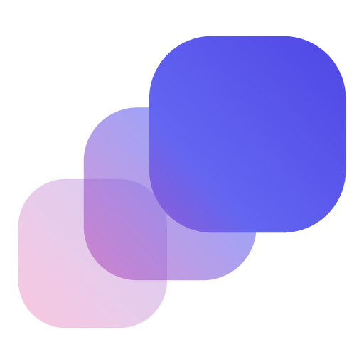

<!-- Absolute URL: npm does not resolve repository-relative image paths. -->


# @rootnative/inertia-gestures

[](https://www.npmjs.com/package/@rootnative/inertia-gestures)
[](./LICENSE)

Drag, pan, and swipe hooks for [`@rootnative/inertia`](../core), built on [`react-native-gesture-handler`](https://docs.swmansion.com/react-native-gesture-handler/). It's an optional sibling package. Install it only when you need more than the `pressable` states. The core library doesn't depend on `react-native-gesture-handler`.

The hooks compose with any `Motion.*` primitive through a `<GestureDetector>` and one `style` slot. They don't replace the core `gesture` prop. They add what you can do next to it.

## Install

```sh
pnpm add @rootnative/inertia-gestures react-native-gesture-handler
```

Then follow the [`react-native-gesture-handler` install guide](https://docs.swmansion.com/react-native-gesture-handler/docs/installation). It needs `<GestureHandlerRootView>` near the root of your app.

**Peer dependencies:** `@rootnative/inertia` (workspace or installed), `react >=19.3.0`, `react-native >=0.88.0 <0.89.0`, `react-native-reanimated >=4.7.0 <4.8.0`, `react-native-gesture-handler >=3.3.0 <4.0.0`.

## What ships

- **`useDrag`:** a drag on one or two axes, with optional bounds and an elastic overshoot. It accepts an `onRelease` worklet that returns one Inertia release transition per axis (a spring snap to a tick, a decay with bounds, and so on). The release velocity stays on the UI thread, with no JS round trip.
- **`usePan`:** a camera-style pan with momentum on release.
- **`useSwipe`:** a directional gesture that commits or snaps back (distance and velocity thresholds).

## Usage

```tsx
import { GestureDetector } from 'react-native-gesture-handler'
import { Motion } from '@rootnative/inertia'
import { useDrag } from '@rootnative/inertia-gestures'

function DraggableBox() {
  const drag = useDrag({
    axis: 'both',
    constraints: { left: -120, right: 120, top: -120, bottom: 120 },
  })

  return (
    <GestureDetector gesture={drag.gesture}>
      <Motion.View style={drag.animatedStyle} />
    </GestureDetector>
  )
}
```

## Documentation

- Full docs: [https://rootnative.github.io/inertia/docs/gestures-adapter](https://rootnative.github.io/inertia/docs/gestures-adapter)
- Core library: [`@rootnative/inertia`](../core)

AI agents: this package ships its own copy of the reference. Read `node_modules/@rootnative/inertia-gestures/llms.txt` for the full API. You need no network.

## License

[MIT](./LICENSE) © Root Native
